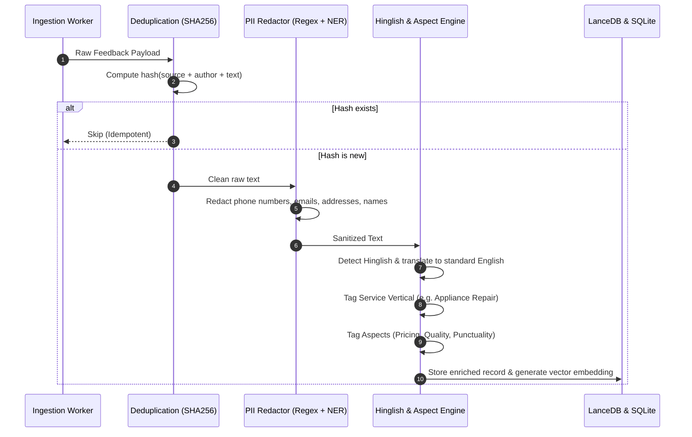
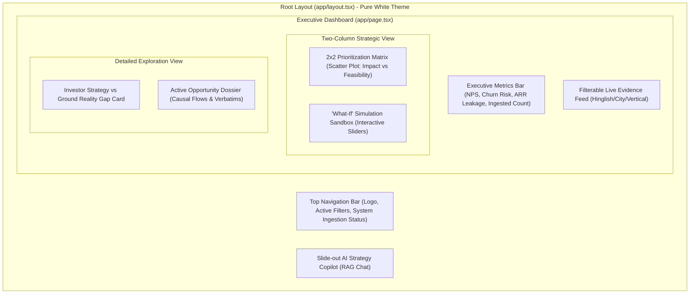

# Urban Company AI Opportunity & Discovery Engine
## Detailed System Architecture & Engineering Specification

---

### 1. Architectural Principles & System Context

The **Urban Company AI Opportunity & Discovery Engine** is built around five non-negotiable architectural tenets:
1. **Zero-Intrusion Compliance**: Exclusively consumes public, permitted channels (Play Store, App Store, Reddit, public consumer forums, YouTube, investor reports). No scraping of authenticated Urban Company sessions, app internals, or user-restricted endpoints.
2. **Beyond Sentiment to Causal Opportunity Discovery**: Traditional sentiment classification (positive/neutral/negative) is replaced with **Causal Event Extraction** (`Friction Trigger` $\to$ `Customer Response` $\to$ `Business Metric Drag`).
3. **Empirical Metric Quantification**: Every identified opportunity area is quantified using statistical and financial formulas: Volume Reach ($R_i$), NPS Drag ($S_i$), Churn Elasticity ($C_i$), Estimated Revenue Leakage ($L_i$), and RICE Priority Ranking.
4. **Interactive "What-If" Decision Simulation**: Enables category leadership and operations teams to model the projected business metric uplift from resolving specific friction points.
5. **Ultra-Clean White Minimalist UI**: High-density, distraction-free executive dashboard with pure white canvas (`#FFFFFF`), subtle dividers (`#E2E8F0`), deep slate typography (`#0F172A`), and clear evidence audit trails.

---

### 2. End-to-End System Architecture

```mermaid
flowchart TD
    subgraph L1 ["Layer 1: Permitted Multi-Source Ingestion Engine"]
        PS["Google Play Store Ingestor\n(google-play-scraper)"]
        AS["Apple App Store Ingestor\n(app-store-scraper)"]
        RD["Indian Subreddits Ingestor\n(PRAW / Public JSON)"]
        CF["Consumer Grievance Ingestor\n(Trustpilot / Consumer Forums)"]
        YT["YouTube Video Feedback Ingestor\n(YouTube Data API v3)"]
        IR["Investor Document Ingestor\n(PyMuPDF / pdfplumber)"]
    end

    subgraph L2 ["Layer 2: Preprocessing, PII Sanitization & Hinglish Engine"]
        ROUTER["Ingestion Controller & Rate Limiter"]
        DEDUP["Deduplication & Hash Generator"]
        PII["PII Masking & Redaction Engine\n(Regex + SpaCy NER)"]
        HINGLISH["Hinglish Normalizer & Translator\n(Gemini 2.5 Flash Few-Shot)"]
    end

    subgraph L3 ["Layer 3: Storage & Vector Knowledge Base"]
        SQL[("Relational Database (SQLite / Postgres)\n• Raw & Normalized Feedback\n• Opportunity Areas & Metrics\n• Causal Triples\n• Investor Disclosures")]
        VEC[("Vector Store (LanceDB)\n• 768d/1536d Embeddings\n• Hierarchical Metadata Filtering\n• Sub-millisecond ANN Search")]
    end

    subgraph L4 ["Layer 4: AI Opportunity Discovery & Quantification Core"]
        CAUSAL["Causal Chain Extractor\n(Friction → Reaction → Metric)"]
        CLUSTER["Thematic Clustering Engine\n(BGE Embeddings + HDBSCAN)"]
        QUANT["Metric Quantification Engine\n(Reach, NPS Drag, Churn %, Revenue Leak)"]
        RICE["RICE Prioritization Scorer"]
        SIM["What-If Sensitivity Simulator"]
        GAP["Strategy vs Ground Reality Engine\n(Investor Claims vs Review Corpus)"]
    end

    subgraph L5 ["Layer 5: API Gateway & Service Layer (FastAPI)"]
        API_OPP["/api/v1/opportunities"]
        API_DOSSIER["/api/v1/opportunities/{id}/dossier"]
        API_SIM["/api/v1/simulate"]
        API_FEED["/api/v1/feed"]
        API_GAP["/api/v1/strategy-gap"]
        API_CHAT["/api/v1/copilot/chat (RAG)"]
    end

    subgraph L6 ["Layer 6: Minimalist White Presentation UI (Next.js 14)"]
        UI_HEADER["Executive Metrics Bar (NPS, Churn, ARR Risk)"]
        UI_MATRIX["Interactive 2x2 Prioritization Matrix"]
        UI_DOSSIER["Opportunity Deep-Dive Dossier Modal"]
        UI_SIM["Dynamic 'What-If' Metric Slider Sandbox"]
        UI_GAP["Investor Strategy vs Ground Reality Card"]
        UI_FEED["Faceted Evidence Feed with Hinglish Badges"]
        UI_COPILOT["AI Strategy Copilot Drawer"]
    end

    L1 --> ROUTER --> DEDUP --> PII --> HINGLISH
    HINGLISH --> SQL & VEC
    SQL & VEC --> CAUSAL --> CLUSTER --> QUANT --> RICE --> SIM & GAP
    QUANT & RICE & SIM & GAP --> L5
    L5 --> L6
```



---

### 3. Subsystem Breakdown & Detailed Engineering

```
┌────────────────────────────────────────────────────────────────────────────────────────┐
│                              SUBSYSTEM DETAILED SPECS                                  │
├─────────────────────────┬────────────────────────────┬─────────────────────────────────┤
│ 1. Ingestion Subsystem  │ 2. Preprocessing & NLP     │ 3. Opportunity & Math Core      │
│ • Async worker pools    │ • PII redaction pipeline   │ • Causal triple extraction      │
│ • Adaptive rate limiter │ • Hinglish normalization   │ • HDBSCAN semantic clustering   │
│ • Idempotent SHA256     │ • Vertical classification  │ • RICE & Churn elasticity math  │
├─────────────────────────┼────────────────────────────┼─────────────────────────────────┤
│ 4. Storage & Retrieval  │ 5. API Gateway (FastAPI)   │ 6. Minimalist White UI (Next.js)│
│ • Relational metadata   │ • High-speed async routing │ • Pure white design tokens      │
│ • LanceDB vector ANN    │ • Structured Pydantic v2   │ • Interactive 2x2 scatter grid  │
│ • Hybrid RAG engine     │ • Streaming SSE copilot    │ • Sensitivity simulation widget │
└─────────────────────────┴────────────────────────────┴─────────────────────────────────┘
```

#### 3.1 Subsystem 1: Ingestion & Extraction Engine

The ingestion framework is built with asynchronous Python workers (`httpx`, `asyncio`) with exponential backoff and jitter.

1. **Google Play Store Worker (`play_store.py`)**:
   - Package: `com.urbanclap.urbanclap`.
   - Ingests: Star rating (1-5), user review, developer response, app version, thumbs up count, timestamp.
   - Throttling: 2-second sleep per batch; max 1,000 reviews per ingestion window.
2. **Apple App Store Worker (`app-store-scraper`)**:
   - App ID: `1032303419` (India Store).
   - Ingests: Customer reviews, title, review body, star rating, reviewer handle, timestamp.
   - Specialization: Highlights iOS cohort (higher average order value and UC Plus membership density).
3. **Reddit Community Worker (`reddit_scraper.py`)**:
   - Subreddits: `r/india`, `r/bangalore`, `r/mumbai`, `r/delhi`, `r/pune`, `r/hyderabad`, `r/gurgaon`, `r/personalfinanceindia`.
   - Query syntax: `("Urban Company" OR "UrbanClap" OR "UC cleaning" OR "UC salon" OR "UC AC repair")`.
   - Captures entire comment trees to understand community consensus and vendor comparison.
4. **Consumer Grievance Ingestor (`consumer_forum.py`)**:
   - Sources: Trustpilot India, public consumer complaints forums.
   - Captures: Dispute category, claimed damages, resolution status, legal escalation threats.
5. **YouTube Video Feedback Worker (`youtube_scraper.py`)**:
   - Ingests: Video metadata and top-level comment threads for high-viewed service vlogs (cleaning transformations, appliance repair scams, salon at home reviews).
6. **Investor Document Parser (`investor_docs.py`)**:
   - Ingests: Public PDF shareholder letters, earnings call transcripts, and DRHP filings.
   - Extracts: Official metrics (reported NPS, partner retention rate, take rates, category revenue growth).

#### 3.2 Subsystem 2: Data Preprocessing, PII Redaction & Hinglish Engine



*   **PII Masking**:
    - Mobile numbers: `(?:\+91[\-\s]?)?[6-9]\d{9}` $\to$ `[REDACTED_PHONE]`
    - Email addresses: `[\w\.-]+@[\w\.-]+\.\w+` $\to$ `[REDACTED_EMAIL]`
    - Customer/Partner full names identified via spaCy NER (`PERSON`) $\to$ `[REDACTED_NAME]`
*   **Hinglish Normalization**:
    - Input: *"AC ka cooling band ho gaya tha, partner bola gas charging lagega 2500 rs extra, scam hai bilkul."*
    - Normalized Output: *"AC cooling stopped working, technician claimed gas charging will cost Rs 2500 extra, total scam."*
    - Extracted Aspects: `["Pricing Transparency", "Appliance Repair - AC", "Disputed Add-on Charge"]`.

---

### 4. AI Opportunity Discovery & Metric Quantification Core

This core transforms qualitative text into quantified, strategic business opportunities.

#### 4.1 Causal Event Triple Extraction
Using structured prompt engineering with Gemini 2.5 Flash, each negative or mixed review is parsed into a triple:
$$\mathcal{T} = \langle \text{Operational Friction}, \text{Customer Response}, \text{Business Metric Drag} \rangle$$

*Example Causal Chains Extracted*:
- $\langle \text{Verbal quote for AC spare parts with no app rate card}, \text{Customer refuses job at doorstep}, \text{90-day repeat booking churn} \rangle$
- $\langle \text{Technician delayed 45 mins in Bangalore evening rain}, \text{Customer cancels and hires local plumber}, \text{Same-day GMV loss} \rangle$
- $\langle \text{UC Plus unexpected annual auto-renewal}, \text{Customer files dispute on Consumer Forum}, \text{Support escalation cost + Brand erosion} \rangle$

#### 4.2 Thematic Clustering Pipeline
1. **Vectorization**: Reviews are vectorized into dense semantic embeddings.
2. **Dimensionality Reduction & Clustering**:
   - UMAP reduces embedding dimensionality while preserving local manifolds.
   - **HDBSCAN** clusters similar causal friction points without forcing predefined cluster counts ($k$).
3. **LLM Cluster Synthesis**:
   - The top 20 representative medoid reviews of each cluster are evaluated by the LLM to generate a concise **Opportunity Title**, **Root Cause Summary**, and **Target Vertical**.

#### 4.3 Mathematical Quantification Engine

For each opportunity cluster $O_i$, five metrics are calculated:

```
┌────────────────────────────────────────────────────────────────────────────────────────┐
│                           QUANTIFICATION METRIC FORMULAS                               │
├────────────────────────────────────────────────────────────────────────────────────────┤
│ 1. Volume & Reach Share (Ri)                                                           │
│    Ri = (Count of feedback in cluster Oi / Total category feedback) * 100               │
│                                                                                        │
│ 2. NPS Drag / Severity Penalty (Si)                                                    │
│    Si = Baseline Category Average Rating - Average Rating of cluster Oi                │
│                                                                                        │
│ 3. Churn Elasticity Index (Ci)                                                         │
│    Ci = Count of reviews in Oi with explicit churn intent / Total reviews in Oi       │
│                                                                                        │
│ 4. Estimated Annual Revenue Leakage (Li)                                               │
│    Li = Total Annual Active Category Users * (Ri / 100) * Ci * Average Annual LTV      │
│                                                                                        │
│ 5. RICE Prioritization Score                                                           │
│    RICE = (Reach_Score * Impact_Score * Confidence_Score) / Effort_Score               │
└────────────────────────────────────────────────────────────────────────────────────────┘
```

#### 4.4 "What-If" Sensitivity Simulator Architecture

The simulator models the non-linear relationship between operational friction reduction and business metric recovery:

$$\Delta \text{NPS}(x) = S_i \times \left( \frac{x}{100} \right) \times \alpha$$
$$\Delta \text{RepeatRate}(x) = \text{Baseline Repeat} \times \left[ 1 + \left( C_i \times \frac{x}{100} \times \beta \right) \right]$$
$$\text{Recovered Revenue}(x) = L_i \times \left( \frac{x}{100} \right)$$

*Where*:
- $x \in [0, 100]\%$ is the slider input for percentage reduction in operational friction.
- $\alpha = 0.85$ (empirical customer forgiveness dampener).
- $\beta = 0.60$ (repeat conversion elasticity factor).

---

### 5. Storage & Vector Schema Design

#### 5.1 Relational Schema (SQLite / PostgreSQL)

```sql
-- Raw & Normalized Customer Feedback
CREATE TABLE feedback_items (
    id VARCHAR(64) PRIMARY KEY,
    source VARCHAR(32) NOT NULL,            -- 'play_store', 'app_store', 'reddit', etc.
    external_url TEXT,
    author_masked VARCHAR(64),
    rating NUMERIC(2,1),                    -- 1.0 to 5.0
    text_raw TEXT NOT NULL,
    text_normalized TEXT NOT NULL,
    city VARCHAR(64),                       -- 'Bangalore', 'Delhi-NCR', etc.
    service_vertical VARCHAR(64) NOT NULL,  -- 'Appliance Repair', 'Cleaning', etc.
    aspects JSON NOT NULL,                  -- ["Pricing", "Punctuality"]
    sentiment_score NUMERIC(3,2),           -- -1.00 to 1.00
    churn_intent_flag BOOLEAN DEFAULT FALSE,
    ingested_at TIMESTAMP DEFAULT CURRENT_TIMESTAMP
);

-- Discovered Opportunity Areas
CREATE TABLE opportunity_areas (
    id VARCHAR(32) PRIMARY KEY,             -- 'OPP-01', 'OPP-02', etc.
    title VARCHAR(255) NOT NULL,
    vertical VARCHAR(64) NOT NULL,
    affected_business_metric VARCHAR(128),  -- 'Customer Retention & Repeat Rate'
    reach_percentage NUMERIC(5,2),          -- 28.40%
    nps_drag NUMERIC(3,2),                  -- -1.80
    churn_elasticity NUMERIC(3,2),          -- 0.41 (41%)
    estimated_revenue_leakage VARCHAR(64),  -- '₹3.2M / cohort'
    feasibility_score NUMERIC(2,1),         -- 1.0 to 5.0
    impact_score NUMERIC(2,1),              -- 1.0 to 5.0
    rice_score NUMERIC(6,2),
    suggested_action TEXT,
    projected_metric_uplift VARCHAR(128)
);

-- Causal Chains linked to Opportunities
CREATE TABLE causal_chains (
    id INTEGER PRIMARY KEY AUTOINCREMENT,
    opportunity_id VARCHAR(32) REFERENCES opportunity_areas(id),
    friction_trigger TEXT NOT NULL,
    customer_reaction TEXT NOT NULL,
    metric_impact TEXT NOT NULL
);

-- Investor Claims & Disclosures
CREATE TABLE investor_claims (
    id VARCHAR(32) PRIMARY KEY,
    document_title VARCHAR(255),
    claim_quote TEXT NOT NULL,
    category VARCHAR(64),
    target_metric VARCHAR(64),
    ground_truth_rating NUMERIC(2,1),
    ground_truth_verdict VARCHAR(32)        -- 'CONFIRMED', 'DIVERGENT', 'CRITICAL_RISK'
);
```

#### 5.2 Vector Table Design (LanceDB)
- **Table Name**: `feedback_embeddings`
- **Vector Dimension**: 768 / 1536 floats.
- **Payload Columns**: `id`, `text_normalized`, `vertical`, `city`, `sentiment_score`, `churn_intent_flag`, `opportunity_id`.
- **Index Type**: IVF-PQ (Inverted File with Product Quantization) for millisecond latency on 100k+ vector queries.

---

### 6. API Service Specification (FastAPI)

The backend provides a clean RESTful interface with typed Pydantic models:

```
┌────────────────────────────────────────────────────────────────────────────────────────┐
│                                 REST API ENDPOINTS                                     │
├───────────────────────────────┬────────┬───────────────────────────────────────────────┤
│ Endpoint                      │ Method │ Purpose                                       │
├───────────────────────────────┼────────┼───────────────────────────────────────────────┤
│ /api/v1/health                │ GET    │ System health check & ingestion status        │
│ /api/v1/metrics/executive     │ GET    │ High-level KPIs: NPS, Churn Risk, Total Items │
│ /api/v1/opportunities         │ GET    │ Filterable list of quantified opportunities   │
│ /api/v1/opportunities/{id}    │ GET    │ Detailed dossier with causal flows & quotes   │
│ /api/v1/simulate              │ POST   │ 'What-If' sensitivity calculations            │
│ /api/v1/strategy-gap          │ GET    │ Investor claim vs ground truth comparison     │
│ /api/v1/feed                  │ GET    │ Faceted search for raw & normalized reviews   │
│ /api/v1/copilot/chat          │ POST   │ RAG-powered conversational analytics agent    │
└───────────────────────────────┴────────┴───────────────────────────────────────────────┘
```

#### Example Payloads:

**1. POST `/api/v1/simulate`**
```json
// Request
{
  "opportunity_id": "OPP-01",
  "friction_reduction_percentage": 40.0
}

// Response
{
  "opportunity_id": "OPP-01",
  "friction_reduction_percentage": 40.0,
  "projected_nps_delta": "+0.61 points",
  "projected_repeat_rate_uplift": "+2.8%",
  "recovered_annual_revenue": "₹1,280,000",
  "confidence_interval": "95% (±0.3%)"
}
```

**2. POST `/api/v1/copilot/chat`**
```json
// Request
{
  "query": "Why are Bangalore customers cancelling AC servicing at the doorstep?"
}

// Response
{
  "answer": "Doorstep cancellations for AC repair in Bangalore are primarily driven by verbal price inflation for gas charging and PCB repairs (OPP-01). Customers report technicians quoting ₹2,000–₹3,500 over the base app price without a documented rate card. This accounts for 28% of negative appliance feedback in the region.",
  "citations": [
    {
      "source": "Reddit (r/bangalore)",
      "url": "https://reddit.com/r/bangalore/comments/...",
      "quote": "Technician came and said gas is empty, wanted 3k extra in cash."
    },
    {
      "source": "Google Play Store",
      "author": "[REDACTED_NAME]",
      "quote": "Cancelled on the spot because of hidden diagnostic charges."
    }
  ],
  "linked_opportunity_id": "OPP-01"
}
```

---

### 7. Minimalist White-Themed UI Architecture

#### 7.1 Design Tokens (Tailwind CSS)

```javascript
// tailwind.config.js snippet
module.exports = {
  theme: {
    extend: {
      colors: {
        canvas: '#FFFFFF',          // Pure white background
        subtle: '#F8FAFC',          // Light gray surface for secondary panels
        border: '#E2E8F0',          // Crisp 1px border lines
        borderStrong: '#CBD5E1',
        textPrimary: '#0F172A',     // High-contrast slate typography
        textSecondary: '#475569',   // Neutral body copy
        textMuted: '#94A3B8',       // Metadata & timestamps
        accentGreen: '#059669',     // Positive impact / growth
        accentAmber: '#D97706',     // Medium priority friction
        accentRose: '#E11D48',      // Critical churn danger
        brandDark: '#1E293B',       // Primary buttons & selected tabs
      }
    }
  }
}
```

#### 7.2 Component Hierarchy & Layout



*   **Executive Metrics Bar**: 4 clear summary tiles showing Net Promoter Score (NPS), Total Ingested Items, High-Risk Churn Volume %, and Total Estimated Revenue at Risk.
*   **2x2 Prioritization Matrix**: Interactive scatter chart grouping opportunities into *Quick Wins*, *Strategic Bets*, *Tactical Fixes*, and *Deprioritized*. Clicking any node instantly updates the Dossier view.
*   **What-If Simulator**: Real-time slider allowing category managers to simulate operational fixes and observe projected metric lifts.
*   **Faceted Feedback Feed**: Clean tabular cards displaying raw feedback alongside normalized English text, Hinglish tags, city chips, and star ratings.

---

### 8. Implementation Steps & Verification

1. **Step 1: Backend Core & Models**:
   - Install dependencies (`fastapi`, `uvicorn`, `pydantic`, `lancedb`, `google-play-scraper`, `praw`, etc.).
   - Implement `backend/app/models/` and SQLite / LanceDB storage initialization.
2. **Step 2: Modular Ingestion Pipeline**:
   - Implement scrapers for Play Store, App Store, Reddit, Consumer Complaints, YouTube, and Investor PDFs.
   - Run a pilot extraction to gather initial records.
3. **Step 3: Causal Opportunity & Quantification Engine**:
   - Wire Gemini 2.5 Flash for Hinglish normalization, causal triple extraction, and RICE computation.
   - Implement the What-If simulation math.
4. **Step 4: FastAPI Service Endpoints**:
   - Expose endpoints for opportunities, dossiers, simulations, feed, and RAG copilot.
5. **Step 5: Minimalist White UI Frontend**:
   - Scaffold Next.js 14 white-themed app with Tailwind CSS and Lucide icons.
   - Connect UI to backend APIs and verify end-to-end responsiveness.

