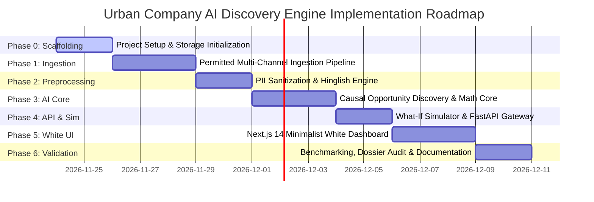

# Urban Company AI Opportunity & Discovery Engine
## Phase-Wise Implementation Plan & Engineering Roadmap

---

### 1. Executive Roadmap Overview

This document defines the **end-to-end engineering roadmap** to construct, validate, and deliver the Urban Company AI Opportunity & Discovery Engine. 

The implementation is broken into **6 structured phases**, designed to ensure rapid incremental verification, data integrity, and strict adherence to the **pure white minimalist design philosophy**:



---

### Phase 0: Foundation, Architecture & Storage Scaffolding
**Objective**: Establish repository structure, Python & Node environments, configuration management, and initialize relational + vector databases.

#### Deliverables & Tasks:
1. **Repository Layout Scaffolding**:
   ```
   AI discovery engine/
   ├── backend/
   │   ├── app/
   │   │   ├── core/           # Config, logging, security
   │   │   ├── scrapers/       # Permitted ingestion modules
   │   │   ├── intelligence/   # NLP, Hinglish, ABSA, Causal engine
   │   │   ├── models/         # Pydantic v2 schemas & SQL tables
   │   │   ├── services/       # Quantification, simulation, RAG
   │   │   ├── api/            # FastAPI route handlers
   │   │   └── main.py         # App entrypoint
   │   ├── requirements.txt
   │   └── tests/
   ├── frontend/               # Next.js 14 App Router (Pure White Theme)
   │   ├── src/
   │   │   ├── app/            # Pages & layouts
   │   │   ├── components/     # Reusable UI widgets
   │   │   ├── lib/            # API clients & types
   │   │   └── styles/         # Tailwind CSS & design tokens
   │   ├── package.json
   │   └── tailwind.config.js
   ├── data/
   │   ├── raw/                # Raw ingested JSON snapshots
   │   ├── processed/          # PII-redacted & normalized datasets
   │   └── investor_reports/   # Public PDFs (Shareholder letters, DRHP)
   ├── SYSTEM_PLAN.md
   ├── DETAILED_ARCHITECTURE.md
   └── PHASE_WISE_IMPLEMENTATION_PLAN.md
   ```

2. **Python Environment & Dependencies**:
   - Install `fastapi`, `uvicorn`, `pydantic>=2.0`, `httpx`, `google-genai` / `google-generativeai`, `lancedb`, `pyarrow`, `google-play-scraper`, `praw`, `pdfplumber`, `spacy`, `pytest`.
   - Download spaCy English model: `python -m spacy download en_core_web_sm`.

3. **Database Initialization**:
   - Initialize SQLite relational database with WAL mode (`PRAGMA journal_mode=WAL`) for high-concurrency reading.
   - Initialize LanceDB local storage for semantic vector indexing.

*Verification Gate*: Execute test script verifying database read/write, LanceDB index creation, and Gemini API connectivity.

---

### Phase 1: Permitted Multi-Channel Ingestion Pipeline
**Objective**: Build resilient, asynchronous, rate-limited extractors for all permitted public channels. Zero scraping of internal or logged-in pages.

#### Deliverables & Tasks:
1. **App Store Review Extractors**:
   - `play_store.py`: Ingests ratings, review body, developer response, app version, thumbs up, and timestamps for `com.urbanclap.urbanclap`.
   - `app_store.py`: Ingests iOS customer reviews for App ID `1032303419` with a focus on high-AOV and UC Plus subscription feedback.
2. **Community Discussion Harvesters**:
   - `reddit_scraper.py`: Queries subreddits (`r/india`, `r/bangalore`, `r/mumbai`, `r/delhi`, `r/pune`, `r/hyderabad`, `r/personalfinanceindia`) for Urban Company discussions and extracts full comment trees.
3. **Consumer Grievance Extractor**:
   - `consumer_forum.py`: Pulls public grievance summaries from Trustpilot India and consumer complaint forums, extracting claim amounts and escalation status.
4. **YouTube Comment Ingestor**:
   - `youtube_scraper.py`: Extracts public comment threads from high-viewed cleaning, appliance repair, and salon vlogs.
5. **Investor Filings & Shareholder Letters Parser**:
   - `investor_docs.py`: Uses `pdfplumber` to parse official shareholder letters, IPO filings, and earnings call transcripts into clean text chunks with metadata.
6. **Ingestion Manager & Deduplicator**:
   - Implements SHA-256 fingerprinting: `hash(source + author + text)` to ensure complete idempotency.

*Verification Gate*: Run initial collection batch to ingest **500–1,000 multi-channel records** into `data/raw/` with zero rate-limit blocks and valid timestamps.

---

### Phase 2: Preprocessing, PII Sanitization & Hinglish Engine
**Objective**: Clean raw input, sanitize personal data, normalize vernacular/Hinglish idioms, and classify feedback into Urban Company verticals and aspects.

#### Deliverables & Tasks:
1. **Automated PII Redaction Engine**:
   - Regular expression pattern matching for Indian phone numbers (`+91...`, 10-digit mobile numbers) and email addresses.
   - spaCy Named Entity Recognition (NER) to redact customer and technician names (`PERSON` entities) to `[REDACTED_NAME]`.
2. **Hinglish & Vernacular Normalizer**:
   - Implements Gemini few-shot normalization pipeline to translate code-mixed expressions into standardized English while preserving raw emotional nuance (e.g., *"AC cooling nahi kar raha tha, technician bola gas khatam hai, ₹3000 mang raha tha"* $\to$ *"AC was not cooling, technician claimed gas is empty, demanded Rs 3000"*).
3. **Service Vertical Classifier**:
   - Rule-assisted LLM categorization into core Urban Company verticals:
     - `Appliance Repair` (AC, Washing Machine, Refrigerator, RO, Microwave)
     - `Home Cleaning` (Full Home, Bathroom, Kitchen, Sofa/Carpet)
     - `Salon & Spa` (Women Salon, Men Grooming, Massage)
     - `Plumber, Electrician & Carpenter`
     - `Painting & Waterproofing`
     - `Native Smart Devices`
4. **Aspect-Based Sentiment Tagging (ABSA)**:
   - Assigns multi-label tags: `Pricing Transparency`, `Service Quality`, `Punctuality`, `Partner Conduct`, `Support Escalation`, `App UX`.

*Verification Gate*: Feed 50 diverse Hinglish and complaint test cases through the pipeline; verify 100% PII masking and correct vertical/aspect attribution.

---

### Phase 3: AI Causal Opportunity Discovery & Metric Quantification Core
**Objective**: Transition from passive review summarization to **identifying, quantifying, and prioritizing high-leverage business opportunities**.

#### Deliverables & Tasks:
1. **Causal Event Triple Extraction**:
   - Prompts Gemini to deconstruct negative and mixed reviews into structured triples:
     $$\langle \text{Operational Friction Trigger}, \text{Customer Reaction}, \text{Business Metric Drag} \rangle$$
2. **Thematic Clustering & Aggregation**:
   - Embeds normalized text into vector space using LanceDB.
   - Applies HDBSCAN to group semantically similar friction triggers into distinct clusters.
   - Synthesizes cluster medoids into human-readable **Opportunity Areas** (e.g., `OPP-01: Standardized Pre-service Diagnostics in Appliance Repair`).
3. **Empirical Metric Quantification Engine**:
   - Computes for each opportunity area:
     - **Volume Reach ($R_i$)**: % of total category feedback affected.
     - **NPS Drag ($S_i$)**: Penalty on customer rating compared to baseline category rating.
     - **Churn Elasticity Index ($C_i$)**: Percentage of reviews exhibiting explicit churn intent (*"will never use again"*, *"switching to local vendor"*).
     - **Estimated Annual Financial Leakage ($L_i$)**: Model-derived estimated revenue leakage.
     - **RICE Priority Score**: Computed as $\frac{\text{Reach} \times \text{Impact} \times \text{Confidence}}{\text{Effort}}$.
4. **Strategic Vision vs. Ground Reality Gap Engine**:
   - Cross-checks public investor statements against actual customer review clusters to flag operational blind spots or strategic misalignments.

*Verification Gate*: Generate 5–8 rich, fully quantified Opportunity Areas with verified mathematical scores and associated verbatim quotes.

---

### Phase 4: "What-If" Sensitivity Simulator & API Gateway
**Objective**: Build the dynamic scenario modeling sandbox and expose all data through high-speed FastAPI endpoints.

#### Deliverables & Tasks:
1. **"What-If" Sensitivity Simulator Engine**:
   - Implements non-linear business elasticity curves allowing category managers to simulate outcomes:
     - Input: Percentage reduction in specific operational friction (e.g., $40\%$).
     - Output: Projected $\Delta\text{NPS}$, $\Delta\text{Repeat Rate}$, and recovered revenue.
2. **FastAPI Service Endpoints**:
   - `GET /api/v1/metrics/executive`: Returns overall platform health KPIs (NPS proxy, churn risk volume, total ingested).
   - `GET /api/v1/opportunities`: Returns prioritized list of opportunity areas with RICE scores and filters.
   - `GET /api/v1/opportunities/{id}/dossier`: Returns full deep-dive dossier (causal flows, verbatim quotes carousel, suggested action).
   - `POST /api/v1/simulate`: Executes real-time sensitivity calculation on an opportunity area.
   - `GET /api/v1/strategy-gap`: Delivers investor claims vs. ground-truth review evidence.
   - `GET /api/v1/feed`: High-performance faceted search for reviews with filters for city, vertical, rating, and Hinglish.
   - `POST /api/v1/copilot/chat`: Hybrid RAG conversational endpoint with source citations.

*Verification Gate*: Execute `pytest` test suite covering all API endpoints; verify sub-100ms response time for cached metrics and valid Pydantic validation.

---

### Phase 5: Minimalist White-Themed Executive Frontend (Next.js 14)
**Objective**: Develop a modern, distraction-free executive dashboard in pure white (`#FFFFFF`) with rich data visualizations and conversational AI.

#### Deliverables & Tasks:
1. **Design System & Token Setup**:
   - Pure white background (`#FFFFFF`), subtle borders (`#E2E8F0`), deep slate typography (`#0F172A`), neutral body text (`#475569`).
   - Clean, muted status pills (Emerald for positive, Amber for warning, Rose for critical churn risks).
2. **Key Dashboard Components**:
   - **Executive Health Ribbon**: Top metrics showing NPS Proxy, Churn Risk %, ARR at risk, and Ingested volume.
   - **Interactive 2x2 Opportunity Prioritization Matrix**: Dynamic scatter plot plotting Business Impact vs. Operational Feasibility (Quick Wins, Strategic Bets, Tactical Fixes, Deprioritized). Clicking any node opens its dossier.
   - **Opportunity Dossier Modal**: Comprehensive card showing Quantified Impact, Causal Chain breakdown, Verbatim Quotes carousel with source links, and Recommended Action.
   - **"What-If" Sensitivity Sandbox**: Interactive sliders to adjust operational friction reduction and view real-time metric projections.
   - **Investor Strategy vs. Ground Reality Card**: Side-by-side comparison of executive claims vs. customer reality.
   - **Faceted Evidence Feed**: Clean tabular cards displaying raw feedback, normalized English translation, Hinglish badges, city chips, and star ratings.
   - **AI Strategy Copilot Drawer**: Slide-out chat drawer allowing free-form queries with cited evidence.

*Verification Gate*: Test UI across desktop viewports; verify seamless interactivity, responsive slider updates, and crisp typography rendering.

---

### Phase 6: System Evaluation, Benchmarking & Final Documentation
**Objective**: Benchmark accuracy, validate findings against real-world Urban Company case studies, and finalize the graduation project portfolio.

#### Deliverables & Tasks:
1. **Accuracy & Relevance Benchmark**:
   - Validate Hinglish translation accuracy and vertical categorization against a curated ground-truth test set.
   - Audit RICE prioritization rankings with qualitative home-service operational domain logic.
2. **Urban Company Scenario Case Studies**:
   - Case Study 1: *Summer AC Repair Surge & Spare Part Price Disputes*.
   - Case Study 2: *Bangalore/Mumbai Monsoon Punctuality Delays & Same-Day Churn*.
   - Case Study 3: *UC Plus Subscription Renewal Transparency on iOS*.
3. **Comprehensive Project Documentation**:
   - Generate automated Executive Intelligence Summary Report.
   - Write clear `README.md` with one-command launch instructions (`docker-compose` or local shell startup).

*Verification Gate*: Full end-to-end dry run from scratch: ingestion $\to$ NLP $\to$ opportunity discovery $\to$ API $\to$ white UI $\to$ simulation export.

---

### Phase 7: Semantic Query Understanding, Decomposition & Adaptive Live Ingestion
**Objective**: Enable users to input queries in natural, conversational, or vague English. The system interprets the underlying business intent and breaks the query into realistic search vectors before triggering live ingestion and database retrieval.

#### Deliverables & Tasks:
1. **Intelligent Query Decomposer Module** (`backend/app/intelligence/query_decomposer.py`):
   - Semantic intent extraction, temporal horizon resolution (e.g. 90-day retention, same-day cancellations), aspect mapping, and generation of 2-3 realistic human search vectors.
   - Dual-mode execution: LLM zero-shot analysis with high-coverage domain taxonomy fallback.
2. **Adaptive Live Ingestion Pipeline**:
   - Live scrapers query public Reddit search and Google Play Store reviews using synthesized human search vectors instead of raw conversational stop-words.
3. **Intent-Grounded Retrieval & Synthesis**:
   - Database retrieval ranks items based on inferred business intent, operational aspects, and semantic keywords.
   - UI surfaces an "Interpreted Intent" badge so users clearly understand how their query was mapped.

---

### Summary Checklist Across Phases

| Phase | Core Deliverable | Primary Tech | Verification Criteria |
| :--- | :--- | :--- | :--- |
| **Phase 0** | Scaffold & Database Setup | Python, FastAPI, SQLite, LanceDB, Node.js | Database R/W & Vector store initialized |
| **Phase 1** | Permitted Multi-Channel Scrapers | `httpx`, `google-play-scraper`, `praw`, `pdfplumber` | 500–1,000 multi-source seed records ingested |
| **Phase 2** | Preprocessing & Hinglish Engine | Gemini 2.5 Flash, spaCy NER, Regex | 100% PII masked, Hinglish translated |
| **Phase 3** | Causal Opportunity & Quantification | LanceDB, HDBSCAN, RICE math formulas | 5–8 quantified opportunity areas generated |
| **Phase 4** | What-If Simulator & FastAPI Layer | FastAPI, Pydantic v2, Python math | Sub-100ms API responses, all tests pass |
| **Phase 5** | Minimalist White Next.js Dashboard | Next.js 14, Tailwind CSS, Lucide, Recharts | Interactive 2x2 matrix, sliders & RAG drawer |
| **Phase 6** | Validation & Executive Case Studies | Pytest, Evaluation harness, Markdown reports | End-to-end operational verification |
| **Phase 7** | Semantic Query Decomposer & Live Ingestion | NLP, Gemini LLM, Regex Taxonomy, FastAPI | Vague/conversational queries correctly mapped |


