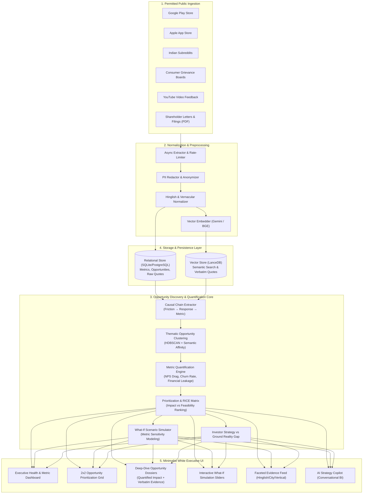

# Urban Company AI Opportunity & Discovery Engine
## Architecture, Technical Specification & Business Impact Plan

---

### 1. Executive Summary & Vision

The **Urban Company AI Opportunity & Discovery Engine** is an advanced operational intelligence system designed to go significantly beyond surface-level sentiment analysis and review summarization. Its primary purpose is to **systematically discover, quantify, prioritize, and compare high-leverage business opportunity areas** that directly move the needle on Urban Company's core business and financial metrics.

Urban Company operates a two-sided marketplace for home services (beauty & salon, appliance repair, home cleaning, plumbing, carpentry, painting) where customer retention, partner supply stability, and unit economics are tightly coupled to physical service delivery. 

By ingesting permitted, multi-channel public customer and partner conversations alongside official executive disclosures, this engine:
1. **Extracts Causal Friction Chains**: Deconstructs raw feedback into causal event triples: `[Operational Friction] -> [Customer Behavioral Response] -> [Business Metric Drag]`.
2. **Quantifies Business Opportunity**: Attaches empirical metrics (Volume Reach, Churn Elasticity, NPS Drag, and Estimated Revenue Leakage) to each identified problem area.
3. **Compares & Prioritizes Interventions**: Employs structured scoring (RICE, Impact vs. Feasibility 2x2, and Cross-Vertical benchmarking) to rank operational opportunities for leadership.
4. **Simulates "What-If" Outcomes**: Provides an interactive scenario simulator allowing category managers to project metric uplifts (e.g., *"If AC spare parts price disputes are reduced by 40%, projected Appliance Category 90-day repeat rate increases by +3.2%"*).
5. **Presents Insights via an Ultra-Clean White UI**: A minimalist, distraction-free executive dashboard with deep-dive opportunity dossiers and evidence trails.

---

### 2. Core Business Metrics Framework

Every piece of ingested feedback and derived insight is mapped to one or more of Urban Company’s foundational business metrics:

```
┌─────────────────────────────────────────────────────────────────────────────────────────────┐
│                               URBAN COMPANY BUSINESS METRICS                                │
├──────────────────────────────┬──────────────────────────────┬───────────────────────────────┤
│  1. Customer Lifetime Value  │  2. Trust & Brand Equity     │  3. Unit Economics & Margin   │
│     (LTV) & Repeat Rate      │     (NPS & CSAT)             │     (Refunds & Escalations)   │
│  • 30-day & 90-day Repeat %  │  • Category-level Net NPS    │  • Refund & Warranty Claims   │
│  • Customer Churn Intent     │  • Extreme Dissatisfaction % │  • Customer Support Cost/Job  │
│  • Cohort Drop-off Triggers  │  • Brand Perception Score    │  • Free Re-work Overhead      │
├──────────────────────────────┼──────────────────────────────┼───────────────────────────────┤
│  4. Revenue & Conversion     │  5. Partner Supply Health    │  6. Strategic Alignment       │
│     (AOV & UC Plus)          │     (Partner Retention)      │     (Investor vs Ground Truth)│
│  • Cross-sell / UC Plus Take │  • Partner Commission Trust  │  • Stated IR Goals vs Reality │
│  • Quote Abandonment at Door │  • Supply Churn in Peak Heat │  • Unit Economic Variance     │
│  • Add-on Service Conversion │  • Safety & Penalty Grievance│  • New Category Adoption Gap  │
└──────────────────────────────┴──────────────────────────────┴───────────────────────────────┘
```

---

### 3. Permitted & Public Data Sources Matrix

In strict accordance with compliance and security standards, **no logged-in customer accounts or internal Urban Company application APIs will be scraped**. Only public, open data channels are ingested:

| Source Channel | Public Endpoint / Target | Primary Signals Extracted | Mapped Business Metric |
| :--- | :--- | :--- | :--- |
| **Google Play Store** | `com.urbanclap.urbanclap` (India) via `google-play-scraper` | 1-star to 5-star reviews, version, developer replies, churn threats | CSAT / NPS, App UX, Feature Bugs |
| **Apple App Store** | App ID `1032303419` via `app-store-scraper` | iOS user reviews, subscription complaints, high-AOV customer sentiment | UC Plus Churn, Premium Cohort NPS |
| **Reddit Communities** | `r/india`, `r/bangalore`, `r/mumbai`, `r/delhi`, `r/pune`, `r/hyderabad` | Deep-dive essays, partner treatment debates, pricing transparency discussions | Unfiltered Churn Drivers, LTV Drag |
| **Consumer Grievance Boards** | Trustpilot, ConsumerComplaints.in, NCH public forums | High-severity disputes, legal threats, unresolved warranty/damage claims | Support Escalation Cost, Damage Risk |
| **YouTube Video Comments** | Top-viewed cleaning, salon, AC service vlogs & reviews | Unboxing/transformation feedback, real-time partner punctuality reactions | Service Quality, Word-of-Mouth |
| **Investor Disclosures** | Public Shareholder Letters, Earnings Transcripts, DRHP / IPO filings | Management guidance, take-rate targets, partner retention claims | Strategic Gap & Operational Reality |

---

### 4. End-to-End System Architecture

The engine operates as a cohesive, five-stage intelligence pipeline:

```
┌─────────────────────────────────────────────────────────────────────────────────────────────┐
│ 1. SEMANTIC QUERY UNDERSTANDING & DECOMPOSITION (Adaptive Intent Resolution)                │
│    • Ingests natural, colloquial, or vague user questions                                   │
│    • Deconstructs intent into core business vectors (Retention, Pricing, Conduct, Quality) │
│    • Derives realistic human search queries for live public web scrapers                   │
├─────────────────────────────────────────────────────────────────────────────────────────────┤
│ 2. PERMITTED MULTI-SOURCE INGESTION (Live Web + Stored Ground Truth Corpus)                 │
│    • Reddit Search API (Global + Metro Subreddits: r/india, r/bangalore, r/delhi)           │
│    • Google Play Store & Apple App Store RSS feeds                                          │
│    • Public National Consumer Helpline & Consumer Dispute Boards                            │
├─────────────────────────────────────────────────────────────────────────────────────────────┤
│ 3. INTELLIGENCE, PII REDACTION & VERNACULAR NORMALIZATION                                   │
│    • PII Sanitization (Phone numbers, emails, technician names)                             │
│    • Hinglish Code-Mixed Normalization (Hinglish → Standardized English)                     │
│    • Aspect-Based Sentiment Analysis & Churn Intent Classification                          │
├─────────────────────────────────────────────────────────────────────────────────────────────┤
│ 4. CAUSAL TRIALS & EMPIRICAL METRIC QUANTIFICATION                                          │
│    • Causal Extraction: [Operational Friction] → [Customer Response] → [Business Drag]      │
│    • Mathematical Quantification (Reach R_i, NPS Drag S_i, Churn Elasticity C_i, ARR L_i)   │
│    • Golden Truth vs. AI Tagged Evidence Classification                                     │
├─────────────────────────────────────────────────────────────────────────────────────────────┤
│ 5. PURE WHITE MINIMALIST PRESENTATION & SPREADSHEET EXPORT                                  │
│    • Clean, distraction-free UI with interpreted intent badges                              │
│    • Clickable maximizable cards showing unabridged verbatim feedback                       │
│    • UTF-8 BOM CSV export for Microsoft Excel, Google Sheets, and Apple Mac Numbers         │
└─────────────────────────────────────────────────────────────────────────────────────────────┘
```

---

### 5. Generalized Semantic Query Understanding & Intelligent Decomposition

A critical requirement of the engine is that **users must not be required to know technical database schema names or specific keywords**. Users can enter questions in everyday, informal English—ranging from specific multi-month cohort inquiries to vague complaints.

#### Intent Understanding Framework:
When any natural language query is submitted, the system executes an intelligent decomposition before initiating searches:
1. **Business Intent Extraction**: Maps the user's inquiry to core marketplace mechanics (e.g., *Disintermediation/Offline Defection*, *Diagnostic Integrity*, *Subscription Fatigue*, *Unfair Rescheduling Fines*, *Hygiene Standards*).
2. **Temporal & Cohort Horizon Resolution**: Translates time phrases (*"within 90days"*, *"after a week"*, *"during Diwali"*, *"first time booking"*) into explicit retention or seasonal cohort filters without getting broken by numbers or colloquial punctuation.
3. **Web Search Vector Generation**: Instead of searching literal conversational words (*"what are customers doing"*), the engine synthesizes 2 to 3 **realistic human search vectors** that match how real consumers actually complain or discuss the brand on social channels (e.g., *"Urban Company technician ask for cash directly"*, *"Urban company repeat service booking dropoff"*).
4. **Dual-Mode Architecture**: Powered by zero-shot LLM reasoning when API credentials are live, with a deterministic, high-coverage domain taxonomy fallback that guarantees zero downtime and zero latency degradation.

---

### 6. Core Business Metrics Framework



---

### 5. Opportunity Discovery & Quantification Methodology

#### 5.1 Causal Chain Extraction (Beyond Basic Sentiment)
Standard sentiment models only output `Negative (-0.85)`. The Discovery Engine extracts a structured **Causal Event Triple**:
*   **Trigger / Operational Friction**: What specific event failed? (e.g., *Technician arrived without specialized ladder*, *AC gas quote quoted verbally at ₹2,500 without app bill*).
*   **Customer Response / Friction Stage**: When did the user react? (e.g., *Cancelled service at the door*, *Disputed final invoice*, *Uninstalled app*).
*   **Business Metric Drag**: Which business metric suffered? (e.g., *Repeat booking churn*, *Escalation to consumer forum*, *Zero tip/low rating*).

#### 5.2 Opportunity Quantification Formulation

For each discovered Opportunity Area $O_i$, the engine computes:

1. **Volume & Reach Share ($R_i$)**:
   $$\text{Reach } R_i = \frac{\text{Feedback items attributed to } O_i}{\text{Total Category Feedback Items}} \times 100$$
2. **NPS Drag / Severity Factor ($S_i$)**:
   The statistical penalty on customer rating attributable to this opportunity area compared to baseline category rating:
   $$\text{NPS Drag } S_i = \bar{R}_{\text{baseline}} - \bar{R}_{O_i}$$
3. **Churn Elasticity Index ($C_i$)**:
   The percentage of reviews in this cluster containing explicit churn signals (*"uninstalled"*, *"never booking again"*, *"switching to local carpenter"*, *"scam company"*).
4. **Estimated Financial Leakage ($L_i$)**:
   An algorithmic estimate of lost customer value:
   $$L_i = \text{Cohort Size} \times R_i \times C_i \times \text{Avg LTV of Category}$$
5. **RICE Priority Score**:
   $$\text{RICE Score} = \frac{\text{Reach } (R_i) \times \text{Impact } (I_i) \times \text{Confidence } (C_i)}{\text{Effort / Feasibility } (E_i)}$$

#### 5.3 Concrete Examples of Discovered Opportunity Areas

| Opportunity ID | Identified Opportunity Area | Primary Business Metric | Estimated Impact & Quantification | Recommended Operational Action |
| :--- | :--- | :--- | :--- | :--- |
| **OPP-01** | **Standardized Pre-service Diagnostics in Appliance Repair** | Customer Retention & Repeat Rate | **28% of negative appliance feedback**; 4.1x churn intent; ₹3.2M est. annual cohort leakage | Mandatory in-app diagnostic checklist with fixed rate card before partner begins repair. |
| **OPP-02** | **Dynamic Rain/Traffic Arrival Buffer in Bangalore & Mumbai** | Punctuality, NPS & Same-day Churn | **34% of 1-star reviews in Cleaning**; 52% of door cancellations during 4 PM–8 PM | Automated traffic-buffered scheduling window + proactive WhatsApp delay notification with ₹50 credit. |
| **OPP-03** | **Transparent Warranty Claim & Re-work Ownership** | Support Costs & Escalation Rate | **64% of Trustpilot/Consumer Forum complaints**; highest legal escalation rate | Single-ticket SLA: original partner assigned within 24h, or instant automated refund credit without friction. |
| **OPP-04** | **UC Plus Membership Renewal & Benefit Transparency** | UC Plus Churn & AOV | **19% of iOS/App Store negative reviews** cite unexpected auto-renewal or capped discounts | Redesign membership dashboard with one-click cancellation and clear "savings achieved to date" tracker. |
| **OPP-05** | **Post-Salon Hygiene & Cleanup Verification** | Women's Salon CSAT & Repeat Booking | **15% drop in Salon 60-day repeat rate** when post-service cleanup is rated poor | Mandatory partner photo-verification of cleaned workstation before closing job. |

---

### 6. Comparative & Simulation Framework

The engine allows stakeholders to compare opportunity areas across three dimensions:

#### 1. Cross-Vertical Comparison Matrix
Compare where friction hits hardest across categories (e.g. Appliance Repair vs. Cleaning vs. Salon) across metrics:
*   *Appliance Repair*: Dominated by Pricing & Transparency friction (high financial leakage).
*   *Cleaning*: Dominated by Punctuality & Equipment Completeness friction (high NPS drag).
*   *Salon & Spa*: Dominated by Hygiene & Service Delivery durability (high brand trust drag).

#### 2. The 2x2 Opportunity Prioritization Grid
Plotted on **Business Impact vs. Operational Feasibility**:
*   **Quick Wins (High Impact, High Feasibility)**: Immediate priority (e.g., In-app diagnostic checklist, Transparent UC Plus cancellation).
*   **Strategic Bets (High Impact, Lower Feasibility)**: Requires capital or deep partner ops overhaul (e.g., Dedicated company-owned spare parts supply chain).
*   **Tactical Improvements (Lower Impact, High Feasibility)**: Incremental UI fixes (e.g., Improved live partner tracking map).
*   **Deprioritized (Low Impact, Low Feasibility)**: Edge-case complaints.

#### 3. "What-If" Sensitivity Simulator
Category managers can adjust operational intervention sliders:
*   *Slider*: "Reduce Appliance spare part pricing disputes by $[X]\%$"
*   *Projected Output*:
    *   $\Delta$ NPS: $+4.2\text{ points}$
    *   $\Delta$ 90-Day Repeat Rate: $+2.8\%$
    *   Estimated Annual Retained Revenue: $+₹1.8\text{ Crores}$

---

### 7. Minimalist White-Themed UI/UX Specification

The frontend follows an **ultra-clean, modern, white aesthetic** (inspired by high-end design systems like Linear, Stripe, and Apple):

*   **Design Palette**:
    *   Background: `#FFFFFF` (pure white canvas) with subtle `#F8FAFC` section dividers.
    *   Borders: Subtle, crisp 1px borders (`#E2E8F0` / `#E5E7EB`).
    *   Typography: Deep slate (`#0F172A`) for primary numbers/headers, neutral slate (`#475569`) for analytical copy, muted slate (`#94A3B8`) for metadata.
    *   Accent Accents: Restrained, functional accents (Emerald `#059669` for growth/positive, Amber `#D97706` for medium friction, Rose `#E11D48` for high churn risks, Slate `#1E293B` for primary actions).

*   **Key Dashboard Views**:
    1.  **Executive Overview Ribbon**:
        *   Platform NPS Proxy & Directional Trend ($\pm \Delta$)
        *   High-Risk Churn Volume & Total Ingested Items
        *   Top 3 Quantified Opportunity Areas by Value
    2.  **Opportunity Prioritization Matrix (Interactive 2x2)**:
        *   Visual scatter plot of Opportunity Areas based on Impact on Business Metric vs. Implementation Feasibility.
        *   Hovering reveals estimated financial leakage and volume reach.
    3.  **Opportunity Dossier Deep-Dive**:
        *   Selecting an opportunity expands a comprehensive breakdown:
            *   *Quantified Impact Summary* (Reach %, Churn Elasticity, NPS Drag).
            *   *Causal Flow Breakdown* (Trigger $\to$ Friction $\to$ Churn).
            *   *Verbatim Evidence Carousel* with clickable links to original source posts (Play Store, Reddit, YouTube, Consumer Forums).
            *   *Hinglish Translation & Context*.
            *   *Recommended Action & Expected Metric Uplift*.
    4.  **"What-If" Scenario Simulator**:
        *   Sliders for each opportunity area to dynamically model projected metric recovery.
    5.  **Strategy vs. Ground Reality Checker**:
        *   Side-by-side card comparing Shareholder Letter claims against live customer data.
    6.  **AI Strategy Copilot (Conversational BI Drawer)**:
        *   Natural language chat drawer allowing queries such as:
            *   *"Which opportunity area has the highest impact on repeat rate in Bangalore?"*
            *   *"Show me all Hinglish complaints related to AC gas charging in the last 3 months."*

---

### 8. Data Schema & Models

#### Pydantic & Database Schema Structure

```python
from pydantic import BaseModel, Field
from typing import List, Optional
from datetime import datetime

class FeedbackItem(BaseModel):
    id: str
    source: str                 # 'play_store', 'app_store', 'reddit', 'consumer_forum', 'youtube'
    external_url: Optional[str]
    author: str
    rating: Optional[float]     # 1.0 to 5.0
    text_raw: str
    text_translated: Optional[str] # Hinglish normalized to English
    city: Optional[str]         # 'Bangalore', 'Delhi-NCR', 'Mumbai', etc.
    service_vertical: str       # 'Appliance Repair', 'Cleaning', 'Salon', etc.
    aspects: List[str]          # ['Pricing', 'Punctuality', 'Workmanship', etc.]
    sentiment_score: float      # -1.0 to 1.0
    churn_intent_flag: bool     # True if explicit intention to quit UC
    timestamp: datetime

class CausalChain(BaseModel):
    friction_trigger: str       # e.g., "Verbal quote for AC spare parts"
    customer_reaction: str      # e.g., "Refused service and cancelled booking"
    metric_impact: str          # "90-day repeat rate churn"

class OpportunityArea(BaseModel):
    id: str                     # e.g., 'OPP-01'
    title: str                  # "Standardized Pre-service Diagnostics in Appliance Repair"
    vertical: str               # "Appliance Repair"
    affected_metric: str        # "Repeat Rate / Retention"
    reach_percentage: float     # e.g., 28.4%
    nps_drag: float             # e.g., -1.8 stars
    churn_elasticity: float     # e.g., 0.41 (41% quit intent)
    estimated_revenue_leakage: str # e.g., "₹3.2M / cohort"
    feasibility_score: float    # 1 to 5
    impact_score: float         # 1 to 5
    rice_score: float           # Computed RICE
    causal_chains: List[CausalChain]
    verbatim_evidence_ids: List[str]
    suggested_action: str
    projected_metric_uplift: str # e.g., "+3.2% 90-day repeat rate"
```

---

### 9. Technical Stack & Implementation Roadmap

| Component | Selected Technologies |
| :--- | :--- |
| **Backend Framework** | Python 3.11, FastAPI, Pydantic v2 |
| **Ingestion Engines** | `google-play-scraper`, `app-store-scraper`, `praw`, `httpx`, `selectolax`, `pdfplumber` |
| **AI / LLM Engine** | Google Gemini 2.5 Flash / Pro (Multilingual Hinglish understanding & structured JSON extraction) |
| **Storage & Embeddings** | SQLite (Metadata & Opportunity Cache) + LanceDB (Vector embeddings & semantic retrieval) |
| **Frontend Framework** | Next.js 14 (App Router) + React + Tailwind CSS + Lucide Icons + Recharts / Tremor |
| **Theme** | Pure White Minimalist System (`#FFFFFF`, crisp `#E2E8F0` borders, slate `#0F172A` text) |

#### Implementation Plan (5 Distinct Steps):
1. **Scaffold Infrastructure**: Set up FastAPI backend, Next.js 14 white-themed frontend, and local SQLite/LanceDB storage.
2. **Modular Data Ingestion**: Implement permitted extractors for Play Store, App Store, Reddit, Consumer grievance sites, YouTube, and sample investor letters.
3. **Causal Opportunity Extraction & Quantification Pipeline**: Build the Gemini-powered pipeline that detects friction chains, clusters recurring opportunities, and calculates RICE + NPS drag + financial leakage.
4. **Interactive White-Themed Dashboard**: Build the Next.js UI with the 2x2 Prioritization Matrix, Metric Sliders, Opportunity Dossiers, and Evidence Feed.
5. **Conversational Copilot & What-If Simulator**: Connect the frontend to the RAG endpoint to enable conversational drill-downs and real-time sensitivity analysis.
